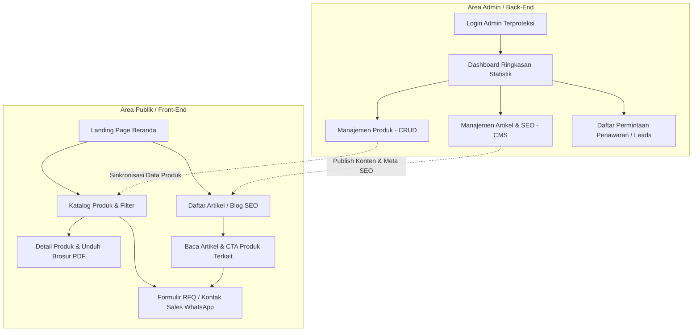

# Product Requirements Document (PRD) & User Requirements Document (URD)
## Proyek: Website Komersial Dispenser Air Minum & Portal Admin (Celiol Dispenser)
**Versi:** 1.1 (Diperbarui dengan Fitur Admin CRUD Produk & Modul Artikel SEO)

---

## 1. Executive Summary & Visi Produk

### 1.1 Visi Produk
Membangun platform website B2B & Komersial modern untuk penyediaan dispenser air minum berkualitas tinggi, higienis, dan ramah lingkungan (gallonless / bottleless POU - *Point of Use* serta solusi dispenser komersial) yang dilengkapi:
1. **Public Showcase**: Landing Page berdaya konversi tinggi dan Katalog Produk interaktif.
2. **Mesin SEO Organik**: Halaman Edukasi & Artikel / Blog B2B untuk mendominasi kata kunci pencarian seputar efisiensi air minum komersial, sanitasi kantor, dan regulasi higienitas.
3. **Portal Admin Terpusat (Admin Dashboard)**: Manajemen data produk mandiri (CRUD Produk) dan publikasi artikel (CMS Artikel) tanpa harus menyentuh kode program.

### 1.2 Target Audiens
- **Publik / Calon Klien B2B**: Facility Manager, Procurement Officer, HR, Pemilik HORECA & Fasilitas Publik.
- **Internal Tim Celiol**: Admin Produk (mengelola stok, model baru, dan spesifikasi) & Content Marketer / SEO Specialist (menerbitkan artikel riset, tips, dan studi kasus).

---

## 2. Arsitektur Informasi & Ruang Lingkup Sistem

Sistem dibagi menjadi dua domain utama: **Area Publik (Front-End)** dan **Area Administrasi (Back-End Admin Portal)**.



---

## 3. Spesifikasi Fungsional: Area Publik (Front-End)

### 3.1 Landing Page (Beranda)
- **Header & Navbar**: Brand logo, navigasi menu (Katalog, Fitur & Teknologi, Industri, Kalkulator ROI, Artikel/Blog), tombol CTA *"Minta Penawaran"* & WhatsApp Direct.
- **Hero Section**: Headline B2B solutif, metrik efisiensi biaya (hemat s/d 60% vs air galon), CTA ganda.
- **Trust & Client Badges**: Logo klien & sertifikasi (BPOM, Kemenkes, NSF, ISO, CE).
- **Segmentasi Industri**: Tab interaktif (Perkantoran, HORECA, Rumah Sakit, Pabrik/Gym).
- **Fitur Unggulan**: Filtrasi 5-Tahap Reverse Osmosis (RO), UV-C LED Sterilization, Sensor Higienis, Smart Eco-Mode.
- **Koleksi Unggulan (Featured Dispensers)**: Diambil otomatis dari produk yang ditandai *Featured* di Admin.
- **Kalkulator Penghematan (Gallon vs Bottleless)**: Simulasi biaya riil bulanan/tahunan.
- **Artikel Terbaru (SEO Hook)**: 3 artikel blog terpopuler/terbaru untuk edukasi calon klien.
- **Formulir Lead Generation (RFQ)**: Input cepat terhubung ke notifikasi/database.
- **Footer**: Kontak resmi, tautan legalitas, tautan artikel, unduh company profile.

### 3.2 Katalog Produk (Product Catalogue Page)
- **Faceted Filter Multi-Kriteria**:
  - *Form Factor* (Floor Standing, Countertop/Tabletop, Heavy Duty, Under-sink).
  - *Opsi Suhu* (Hot & Cold, Hot-Cold-Ambient, Sparkling/Soda).
  - *Kapasitas Karyawan* (10-30 pax, 30-80 pax, 80-200+ pax).
  - *Tipe Filtrasi* (Standar 5-Tahap Reverse Osmosis / RO).
  - *Mekanisme Dispensing* (Touchless Sensor, Push Button).
- **Product Card**: Foto, badges, model code, spesifikasi kunci, tombol aksi (*Quick View Drawer* & *Minta Penawaran*).
- **Quick View / Modal Spesifikasi**: Rincian teknis lengkap, diagram filtrasi, tombol unduh *Spec Sheet (PDF)*.

### 3.3 Halaman Artikel & Blog (SEO-Driven Content Hub)
- **Halaman Indeks Blog (`/blog`)**:
  - Filter kategori artikel (e.g. *Panduan Efisiensi Kantor, Standar Higienitas Air, Studi Kasus B2B, Tren Teknologi POU*).
  - Fitur pencarian artikel & artikel sorotan (*Featured Article*).
  - Kartu artikel dengan estimasi waktu baca (*read time*), tanggal, kategori, dan excerpt ringkas.
- **Halaman Detail Artikel (`/blog/[slug]`)**:
  - Header ramah SEO dengan breadcrumbs terstruktur.
  - Sidebar: Daftar isi artikel (*Table of Contents* otomatis), rekomendasi produk dispenser terkait (*Related Products Widget*), dan form konsultasi cepat.
  - Implementasi teknis SEO: Tag `<h1>` tunggal, Meta Description, Open Graph (WhatsApp/LinkedIn preview), dan JSON-LD Structured Data (`Article` schema).

---

## 4. Spesifikasi Fungsional: Modul Admin Dashboard

Admin Dashboard dibangun dengan tema bersih profesional memanfaatkan tata letak **Preline UI Admin Components** (Sidebar navigasi responsif, header dengan profil admin, tabel data dinamis, dan form interaktif).

### 4.1 Dashboard Utama (Overview & Analytics)
- Kartu Ringkasan: Total Model Aktif, Total Artikel Diterbitkan, Total Prospek/RFQ Masuk Bulan Ini.
- Tabel Cepat: 5 Prospek RFQ terbaru & 5 Artikel dengan pembaca tertinggi.

### 4.2 Modul Manajemen Produk (Product CRUD)

Fitur lengkap untuk mengelola inventaris katalog:

| Operasi | Rincian Fitur & Field Input |
| :--- | :--- |
| **Create (Tambah)** | Form input dengan tab/step:<br>1. **Info Dasar**: Nama Produk, Kode Model (SKU), Slug URL, Kategori/Form Factor, Tag Status (*Featured*, *Best Seller*, *New Arrival*).<br>2. **Spesifikasi Teknis**: Pilihan suhu air (checkbox), Kapasitas tangki (Dingin/Panas/Normal dalam liter), Output liter/jam, Sistem filter (Standar 5-Tahap RO), Rentang kapasitas pengguna (pax).<br>3. **Daya & Dimensi**: Daya pemanas (Watt), Daya pendingin (Watt), Dimensi (P x L x T mm), Berat (kg).<br>4. **Media & File**: Upload foto utama, galeri foto sudut lain, upload file datasheet spesifikasi (PDF).<br>5. **Status Ketersediaan**: Aktif / Draft / Hubungi Sales. |
| **Read (Daftar & Cari)** | Tabel data responsif dengan:<br>- Thumbnail gambar produk, Nama & SKU.<br>- Kategori & badge suhu.<br>- Status ketersediaan (*toggle switch* aktif/nonaktif seketika).<br>- Fitur pencarian instan berdasarkan nama atau SKU.<br>- Filter berdasarkan kategori dan jenis filtrasi.<br>- Tombol aksi cepat: Edit, Hapus, Preview di halaman publik. |
| **Update (Ubah Data)** | Form edit terisi otomatis (*pre-populated*) dengan validasi input, kemampuan mengganti foto atau memperbarui brosur PDF tanpa mengubah URL lama. |
| **Delete (Hapus Produk)** | Konfirmasi modal penghapusan ganda (*Are you sure?*) untuk mencegah penghapusan produk yang tidak disengaja. Dukungan *soft-delete* (arsip). |

### 4.3 Modul Manajemen Artikel & SEO CMS

Dirancang khusus untuk tim konten guna mendongkrak peringkat mesin pencari (Google):

| Operasi | Rincian Fitur & Field Input |
| :--- | :--- |
| **Editor Artikel (Create & Edit)** | 1. **Konten Utama**: Judul Artikel, Slug URL otomatis dari judul (dapat dikustomisasi), Excerpt / Ringkasan (150 karakter), Kategori & Tag.<br>2. **Rich Text Content**: Editor visual (Heading H2/H3, Bullet list, Tabel komparasi, Blockquote, Sisip Gambar & Video edukasi).<br>3. **Gambar Utama (Featured Image)**: Upload banner beresolusi tinggi + kolom `Alt Text` (wajib untuk SEO gambar).<br>4. **Panel Optimasi SEO (SEO Health & Meta Tags)**:<br>&nbsp;&nbsp;&nbsp;- *Focus Keyword* (Kata kunci utama, e.g. "dispenser air kantor terbaik").<br>&nbsp;&nbsp;&nbsp;- *SEO Meta Title* (dengan indikator panjang karakter ideal 50-60 char).<br>&nbsp;&nbsp;&nbsp;- *SEO Meta Description* (indikator panjang karakter 150-160 char).<br>&nbsp;&nbsp;&nbsp;- *Google Search Preview snippet* (menampilkan tampilan saat artikel muncul di hasil pencarian).<br>5. **Penyematan Produk Terkait**: Dropdown untuk memilih 1-2 dispenser yang otomatis tampil di samping/bawah artikel sebagai CTA konversi. |
| **Daftar Artikel (Read & Manage)** | Tabel artikel dengan kolom: Judul, Kategori, Penulis, Tanggal Terbit, Status (*Published* / *Draft* / *Scheduled*), Jumlah Pembaca (*Views*), dan tombol aksi. |
| **Delete & Status Toggle** | Kemampuan menarik artikel kembali ke *Draft* sewaktu-waktu atau menghapus permanen. |

---

## 5. Model & Skema Entitas Data (Data Schema)

### 5.1 Skema Data Produk (`Product`)
```typescript
interface Product {
  id: string;                      // e.g. "prod-cl-st800"
  modelCode: string;               // e.g. "CL-ST800"
  name: string;                    // e.g. "Celiol Titan Standing 800"
  slug: string;                    // e.g. "celiol-titan-standing-800"
  formFactor: 'floor-standing' | 'countertop' | 'heavy-duty' | 'under-sink';
  temperatures: ('hot' | 'cold' | 'ambient' | 'sparkling')[];
  recommendedPax: string;          // e.g. "50 - 120 orang"
  filtrationType: 'RO';            // Standar Baku 5-Tahap RO 0.0001µm
  dispenseType: 'touchless' | 'push-button' | 'touchscreen';
  coolingCapacityLph: number;      // Liter per jam
  heatingCapacityLph: number;
  tankCapacity: {
    cold?: number;
    hot?: number;
    ambient?: number;
  };
  dimensions: string;              // e.g. "360 x 410 x 1150 mm"
  powerWatt: {
    heating: number;
    cooling: number;
  };
  keyFeatures: string[];           // e.g. ["UV-C Tank Sterilization", "5-Stage RO"]
  imageCover: string;
  galleryImages: string[];
  pdfDatasheetUrl?: string;
  isFeatured: boolean;
  status: 'active' | 'draft' | 'archived';
  createdAt: string;
  updatedAt: string;
}
```

### 5.2 Skema Data Artikel / Blog (`Article`)
```typescript
interface Article {
  id: string;                      // e.g. "art-001"
  title: string;                   // e.g. "Hitung Efisiensi Biaya: Air Galon vs Dispenser POU Tanpa Galon di Perkantoran"
  slug: string;                    // e.g. "hitung-efisiensi-biaya-air-galon-vs-dispenser-pou-kantor"
  excerpt: string;                 // Ringkasan untuk kartu preview & meta
  contentHtml: string;             // Isi artikel lengkap format HTML/Markdown
  category: 'Efisiensi Biaya' | 'Sanitasi & Higienitas' | 'Teknologi Filtrasi' | 'Studi Kasus';
  tags: string[];                  // e.g. ["dispenser kantor", "hemat biaya", "POU dispenser"]
  featuredImage: string;
  featuredImageAlt: string;
  author: {
    name: string;
    role: string;
    avatarUrl: string;
  };
  seo: {
    metaTitle: string;
    metaDescription: string;
    focusKeyword: string;
    canonicalUrl?: string;
  };
  relatedProductIds: string[];     // Menghubungkan artikel ke ID Produk relevan
  status: 'published' | 'draft';
  publishedAt: string;
  readTimeMinutes: number;
  viewCount: number;
}
```

---

## 6. Desain Antarmuka & Pemanfaatan Preline UI

### 6.1 Halaman Admin
- **Sidebar Navigation**: Menggunakan *Preline Sidebar Layout* yang dapat di-collapse di perangkat mobile.
- **Data Tables**: Menggunakan *Preline Table with Search & Pagination*, lengkap dengan checkbox aksi massal (*bulk action*).
- **Form Controls & Modals**: Menggunakan *Preline Forms (Floating labels, Custom selects, File upload dropzone)* dan *Preline Overlay Modals* untuk konfirmasi hapus dan quick edit.
- **Alerts & Toast**: Notifikasi sukses / gagal penyimpanan data secara non-intrusif.

### 6.2 Halaman Publik
- Tampilan responsif mobile-first, navigasi sticky dengan drawer hamburger pada layar ponsel.
- Kartu produk modern dengan efek hover halus, badge visual yang jelas.
- Tipografi artikel yang mudah dibaca (*prose styling*) dengan rasio kontras tinggi standar WCAG 2.1 AA.

---

## 7. Rencana Roadmap Pengembangan Terbaru

1. **Tahap 1 (Konseptual & PRD v1.1)**: ✅ Pengesahan PRD lengkap mencakup Landing Page, Katalog, Admin CRUD Produk, dan Blog SEO *(Tahap ini)*.
2. **Tahap 2 (Arsitektur & Prototipe Front-End Publik)**:
   - Pembuatan Landing Page interaktif.
   - Pembuatan Halaman Katalog Produk dengan filter & modal spesifikasi.
   - Pembuatan Halaman Blog (Daftar artikel & Detail baca artikel teroptimasi SEO).
3. **Tahap 3 (Portal Admin & Manajemen CRUD)**:
   - Pembuatan Dashboard Admin.
   - Pembuatan Manajemen Produk (Tabel List, Form Tambah/Edit Produk, Modal Hapus).
   - Pembuatan Manajemen Artikel (Tabel List, Editor Artikel dengan Form Pengaturan SEO).
4. **Tahap 4 (Konektivitas & Integrasi Data)**:
   - Menghubungkan penyimpanan lokal/mock data interaktif sehingga data produk & artikel yang dibuat di Admin langsung tercermin di Katalog dan Halaman Blog publik.
